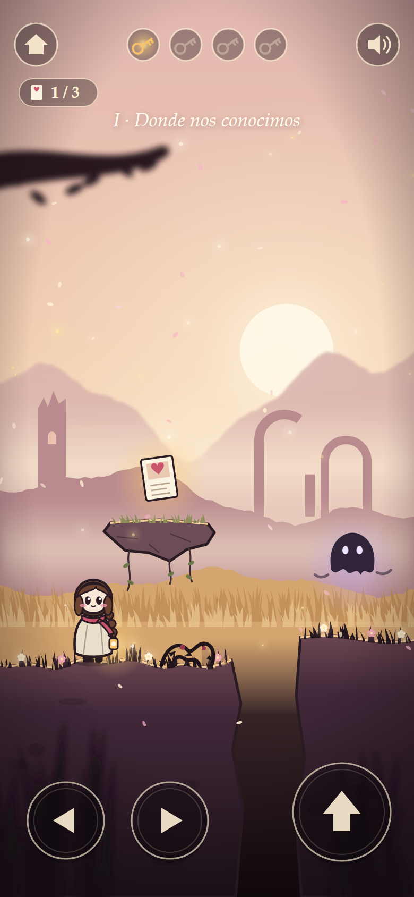
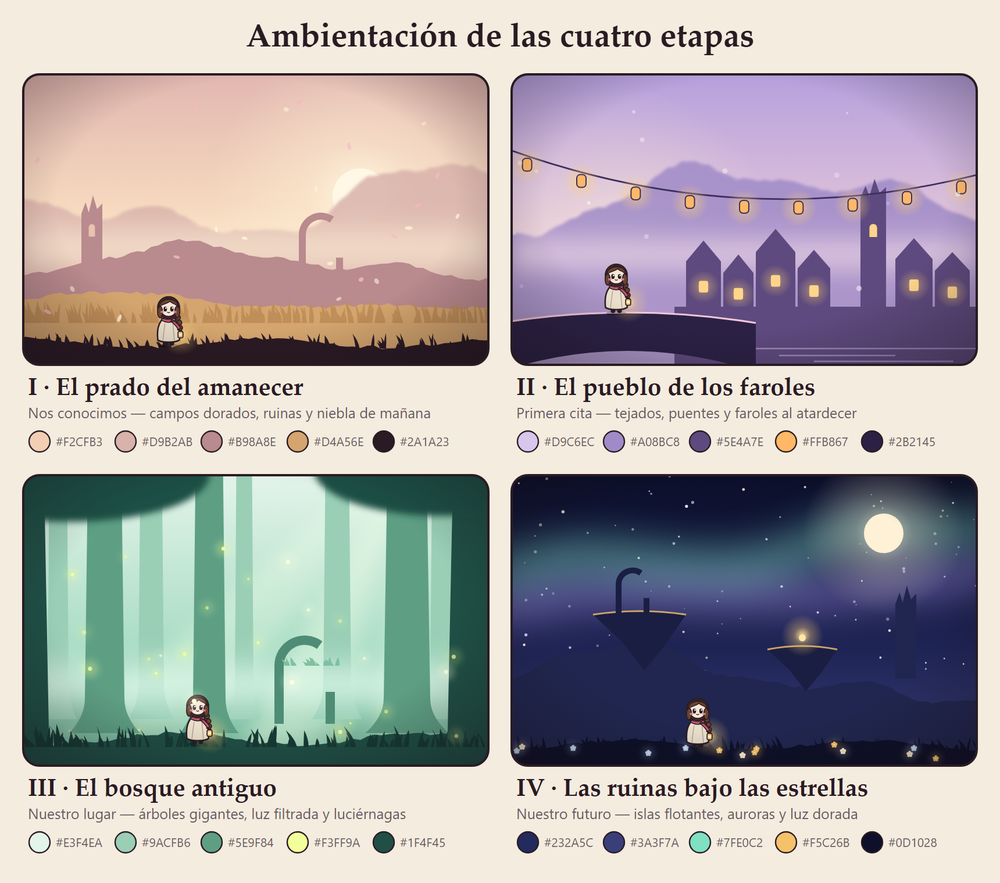
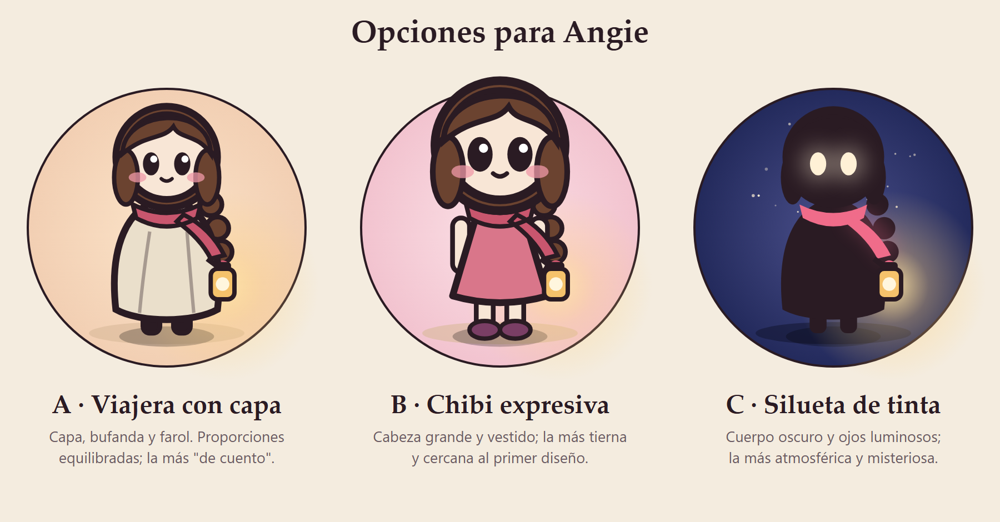
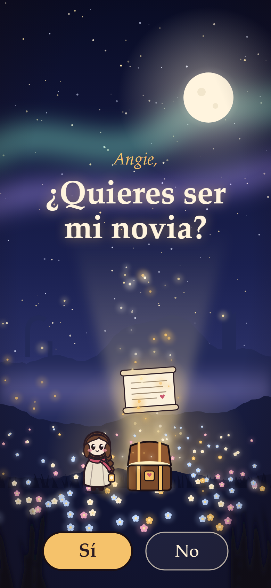

# La aventura de Angie — Propuesta consolidada (v2)

> Documento de diseño para decidir **antes de tocar el código**. Recoge la idea original, lo que ya existe, por qué la versión actual no funciona y las opciones para cada parte del juego, cada una con una recomendación marcada con ★.
> Las imágenes de ejemplo están en [`concepto/`](concepto/), en PNG para verlas y en SVG como archivo fuente.

---

## 1. La idea en una frase

Un juego de plataformas 2D para celular en el que **Angie viaja por cuatro paisajes que representan nuestra historia**. En cada uno corre, salta y esquiva peligros hasta encontrar un **cofre**. Dentro hay un minijuego que le da una **llave**. Con las cuatro llaves abre el **tesoro final**, donde está la pregunta: *"¿Quieres ser mi novia?"*.

---

## 2. Lo que no cambia (requisitos base)

| Área | Requisito |
|---|---|
| Duración | 8–12 minutos sin conocer el juego (~10 min) |
| Idioma y tono | Español; romántico, tierno y con humor ligero |
| Plataforma | Celular en vertical (base 390×844, `Scale.FIT` + `CENTER_BOTH`), Chrome Android y Safari iOS |
| Controles | Solo táctiles, con botones de 48 px como mínimo |
| Rendimiento | 60 fps en un celular de gama media; cero errores en consola |
| Pantalla | Sin zoom accidental; nada fuera de pantalla entre 360 y 430 px de ancho |
| Stack | Phaser 3 (CDN) y JavaScript vanilla, sin bundlers. Archivos `index.html`, `game.js`, `config.js` y `assets/fotos/` |
| Progreso | Las llaves se guardan en `localStorage`; recargar la página no reinicia el progreso |
| Flujo | Boot → Intro → Mapa → Etapas 1–4 → Cofre final → Propuesta |
| Contenido | Todo lo personal va en `config.js`: nombres, recuerdos con foto, texto y fecha, fotos de los minijuegos, ajedrez, trivia y textos finales |
| Fotos | Si falta una foto, aparece un marco de reemplazo y el juego no se rompe |
| Derrota | Mensaje tierno y reintento inmediato, sin castigo |
| Botón "No" | Huye con cada toque; tras 5 intentos se encoge y cambia de texto; al final se convierte en otro "Sí" |
| Audio | Música por etapa y efectos generados por código; opción de usar mp3 propios; botón de silencio siempre visible |

---

## 3. Estado actual (lo que ya está construido)

- **Funciona y se reutiliza:**
  - Guardado de llaves.
  - HUD con las 4 llaves y el botón de silencio.
  - Fundidos de 400 ms.
  - Carga de fotos con marco de reemplazo.
  - Sistema de polaroids.
  - Motor de plataformas: física, salto con margen de tolerancia, salto corto, plataformas móviles, puntos de control, reaparición sin castigo y controles multitáctiles.
  - Diseño de los 4 niveles, probado con un bot: los niveles 1–3 se pueden completar.
- **Se reemplaza:** todo lo visual (personaje, escenarios, enemigos, interfaz), la tipografía y el mapa.
- **Pendiente según el plan original:** minijuegos, cofre final, trivia, propuesta y música.

---

## 4. Diagnóstico: por qué la versión actual se ve sosa

1. **Plana:** casi no hay profundidad, apenas 2–3 capas de fondo sin niebla ni luz. Todo está en el mismo plano.
2. **Colores planos y saturados:** son rellenos sólidos sin degradados, sombras ni iluminación.
3. **Demasiado parecida a Mario:**
   - Suelo de bloques con franja de pasto.
   - Plataformas flotantes rectangulares.
   - Enemigos que se aplastan saltándoles encima.
   - Nubes blancas.

   Es la gramática visual de ese juego, no solo su tipo de juego. Ese fue mi error de interpretación.
4. **Sin atmósfera:** no hay silencio visual, ni escala (personaje pequeño en un mundo grande), ni detalles que cuenten historia.
5. **La cuadrícula se nota:** los bordes rectos y repetidos delatan los tiles.
6. **Tipografía infantil:** Fredoka es redonda y alegre, pero no transmite "cuento" ni "viaje".

---

## 5. Nueva dirección artística: "un cuento de viaje pintado a tinta"

### 5.1 De qué se inspira (y de qué no)

Se toman **cualidades**, no diseños. Nada de personajes, criaturas, símbolos, música, nombres ni composiciones reconocibles de esas obras. Angie, los lugares y los enemigos son originales.

| Toma de… | Qué cualidad |
|---|---|
| *Hollow Knight* (gráficos) | Contornos de tinta a mano; **muchas capas de profundidad** con niebla; siluetas oscuras en primer plano; paleta limitada por zona; luces suaves que brillan; personaje pequeño en un mundo grande; melancolía tranquila |
| *Sōsō no Frieren* (ambiente) | Fantasía **pastoral y luminosa**; el viaje y el paso del tiempo como tema; campos dorados, ruinas antiguas, pueblos con faroles, bosques viejos y cielos estrellados; magia discreta de luz y flores; nostalgia con humor suave |

### 5.2 Pilares visuales

1. **Profundidad:** 5–7 capas de paralaje (cielo, montañas lejanas, niebla, colinas con ruinas, campo medio, suelo jugable y siluetas de primer plano desenfocadas).
2. **Luz:** rayos de sol, halos alrededor de objetos importantes (farol, recuerdos, cofre), luciérnagas, estrellas y bordes iluminados en el suelo.
3. **Tinta:** contorno oscuro de 2–2,5 px en lo jugable (personaje, suelo, peligros) y **sin contorno** en el fondo, para que se lea qué se puede pisar.
4. **Contraste de planos:** fondo claro y brumoso, plano jugable de tono medio y primer plano casi negro. Así se ve "pintado" y se lee bien en una pantalla pequeña.
5. **Formas orgánicas:** el suelo tiene bordes irregulares y nunca se nota la cuadrícula.

### 5.3 Imágenes de ejemplo

**Así se vería jugando (etapa 1):**

En la imagen se ven:
- Las llaves en la parte superior, con la primera ya obtenida.
- El contador de recuerdos.
- La página de diario flotante, que es un recuerdo.
- La plataforma de ruina flotante.
- La zarza de espinas.
- La "sombra del olvido", el enemigo.
- El hueco al vacío.
- Los controles translúcidos sobre el primer plano oscuro.

**Ambientación de las cuatro etapas, con su paleta:**

**Opciones de protagonista:**

**Escena final de la propuesta:**

> Nota honesta: estas imágenes están hechas con vectores generados por código, que es la técnica de la opción B de la sección 6.1. Representan bien la composición, la luz y la paleta. El nivel de "pintado a mano" de un juego profesional solo se alcanza con la opción C.

---

## 6. Opciones por área

### 6.1 Técnica para producir el arte

| Opción | Qué es | Ventajas | Desventajas |
|---|---|---|---|
| A. Todo dibujado en tiempo real (Phaser Graphics) | Lo que hay hoy, pero con capas, niebla y luz | Cumple al pie de la letra "sin sprites externos" y pesa poco | Techo de calidad bajo; las formas orgánicas cuestan mucho |
| **B. Ilustraciones vectoriales (SVG) hechas por mí** ★ | Escenarios, personaje y objetos como archivos `.svg` en `assets/arte/`, que Phaser convierte en texturas al cargar. Las partículas y la luz siguen siendo código | Calidad como la de las imágenes de ejemplo; fáciles de retocar; nada externo ni con derechos de terceros | Más archivos; hay que vigilar el tiempo de carga y el rasterizado en iOS |
| C. Arte pintado (PNG) | Ilustraciones pintadas por ti, por un ilustrador o generadas con IA bajo tu responsabilidad | La máxima calidad, la más cercana al "pintado a mano" | Rompe la regla "sin sprites externos"; depende de conseguir el arte; más peso |

*Recomendación: **B**. Si después quieres más calidad, cualquier capa se puede reemplazar por un PNG pintado (C) sin cambiar el código.*

### 6.2 Protagonista (ver imagen 3)

| Opción | Descripción |
|---|---|
| **A. Viajera con capa** ★ | Capa crema, bufanda rosa, trenza castaña y farol. Mantiene ojos grandes y mejillas, pero con proporciones de cuento |
| B. Chibi expresiva | Cabeza grande y vestido; la más tierna y cercana al diseño original |
| C. Silueta de tinta | Cuerpo oscuro, ojos luminosos y bufanda brillante; la más atmosférica, aunque pierde el parecido con Angie |

**Animaciones:**
- Respirar en reposo.
- Correr con la capa ondeando.
- Salto con estiramiento y aplastamiento.
- Caída.
- Aterrizaje con polvo.
- Celebración al tomar un recuerdo.

**Detalle personal opcional:** algún rasgo real de Angie, por ejemplo un accesorio o un color favorito.

### 6.3 Ambientación de cada etapa (ver imagen 2)

| Etapa | Paisaje | Momento | Paleta propuesta |
|---|---|---|---|
| I · Nos conocimos | **El prado del amanecer**: campos de trigo, torre en ruinas y arcos rotos, niebla matinal y pétalos | Amanecer | `#F2CFB3` `#D9B2AB` `#B98A8E` `#D4A56E` `#2A1A23` |
| II · Primera cita | **El pueblo de los faroles**: tejados, guirnalda de faroles, puente de piedra y río | Atardecer lila | `#D9C6EC` `#A08BC8` `#5E4A7E` `#FFB867` `#2B2145` |
| III · Nuestro lugar | **El bosque antiguo**: árboles gigantes, rayos de luz, arco cubierto de musgo y luciérnagas | Mediodía en la sombra | `#E3F4EA` `#9ACFB6` `#5E9F84` `#F3FF9A` `#1F4F45` |
| IV · Nuestro futuro | **Las ruinas bajo las estrellas**: islas flotantes, aurora y luces doradas | Noche | `#232A5C` `#3A3F7A` `#7FE0C2` `#F5C26B` `#0D1028` |
| Tesoro | **El campo de flores bajo la luna** | Noche | `#0D1028` `#F5C26B` `#FFF1D6` + flores de colores |

**Variantes de paleta:**

| Opción | Descripción |
|---|---|
| **A. Paletas "pintadas" desaturadas (tabla de arriba)** ★ | Mantienen el orden de tus colores originales, pero más suaves |
| B. Tus paletas originales tal cual | Más brillantes y menos melancólicas |
| C. Mayor contraste y oscuridad | Más cercano a *Hollow Knight*, pero menos romántico |

### 6.4 Movimiento y mecánicas

| Opción | Descripción |
|---|---|
| A. Solo correr y saltar | Como hoy; lo más simple |
| **B. Una habilidad nueva por etapa** ★ | Etapa 1: correr y saltar. Etapa 2: **doble salto** ("salto de pétalo"). Etapa 3: **planear** con la capa. Etapa 4: combina las anteriores. Cada habilidad se presenta con un recuerdo |
| C. Además, impulso rápido (dash) y saltar entre paredes | Más profundo, pero más difícil en una pantalla táctil y más largo de ajustar |

**Sensación al jugar (con cualquier opción):**
- Polvo al aterrizar.
- Estiramiento y aplastamiento de la protagonista.
- Cámara que se adelanta en la dirección del movimiento.
- Pequeña sacudida de pantalla al recibir un golpe.
- Pausa breve al tomar un recuerdo.

### 6.5 Estructura de los niveles

| Opción | Descripción |
|---|---|
| A. Lineal de izquierda a derecha (actual) | Simple y rápido de jugar |
| **B. Lineal con tramos verticales y pequeños rincones secretos** ★ | Se sube a ruinas y árboles, y algún corazón o recuerdo extra queda escondido. Se mantiene en unos 90 s por nivel |
| C. Mundo conectado (estilo metroidvania) | Lo más fiel a *Hollow Knight*, pero no cabe en 10 minutos |

### 6.6 Obstáculos y enemigos (originales, no inspirados en Mario)

**Peligros del escenario:**
- **Zarzas** de espinas.
- Agua y vacío.
- Piedras que se desprenden.
- Plataformas de luz que aparecen y desaparecen (etapa 4).

**Enemigos:**
- **Sombras del olvido:** pequeñas manchas de humo con ojos, que flotan y patrullan.
- Polillas en el bosque.
- Faroles traviesos en el pueblo.

| Opción | Descripción |
|---|---|
| A. Se pisan para desaparecer (como hoy) | Recuerda demasiado a Mario |
| **B. Solo se esquivan, y la luz del farol las ahuyenta** ★ | Al acercarse con el farol encendido, las sombras retroceden un momento. Es tierno y temático: la luz de los recuerdos espanta el olvido |
| C. Sin enemigos, solo peligros del escenario | Lo más tranquilo |

Con cualquier opción, un golpe solo empuja y hace parpadear a la protagonista. No hay vidas ni pantalla de derrota.

### 6.7 Recuerdos (las 3 fotos de cada etapa)

| Opción | Descripción |
|---|---|
| A. Polaroid (como hoy) | Sencilla y clara |
| **B. Página de diario de viaje** ★ | Página con foto pegada, texto escrito a mano y fecha, que se abre con un pequeño efecto de pasar página. Al final se puede ver el "diario completo" |
| C. Flor que se abre y deja ver la foto | Más mágica, pero la foto se ve más pequeña |

### 6.8 Mapa

| Opción | Descripción |
|---|---|
| A. Camino serpenteante (actual), con el nuevo estilo | Rápido de rehacer |
| **B. Mapa de viaje dibujado en pergamino** ★ | Ilustración del mapa con los 4 lugares dibujados, línea punteada del recorrido y Angie caminando sobre él. Cada lugar se "colorea" al completarlo |
| C. Mapa lateral desplazable | Más inmersivo, pero más lento de navegar |

### 6.9 Minijuegos (dentro de cada cofre)

Se mantienen las mecánicas pedidas, con dificultad media, y cambia la apariencia:

| Etapa | Mecánica (igual) | Nueva apariencia propuesta |
|---|---|---|
| I | Atrapar: 15 puntos en 45 s, velocidad progresiva | Atrapar **pétalos y estrellas fugaces** con un frasco de cristal; las **sombras** quitan puntos |
| II | Memoria: 12 cartas, 6 parejas, máximo 20 intentos | Cartas como **naipes antiguos** con reverso de farol, volteo en 3D |
| III | Ajedrez: mate en 2 (FEN y solución en config), con pista si falla | **Tablero de piedra** en el claro del bosque, con piezas talladas |
| IV | Rompecabezas deslizante 3×3 (30 movimientos aleatorios), con referencia de 3 s | **Vitral** de una ventana en ruinas; al resolverlo se ilumina |

**Dónde ocurren:**

| Opción | Descripción |
|---|---|
| **A. Al abrir el cofre se pasa a la pantalla del minijuego** ★ | Más claro en un celular |
| B. El minijuego ocurre dentro del nivel | Por ejemplo, atrapar pétalos mientras se corre. Más integrado, pero más complejo y arriesgado en una pantalla pequeña |

### 6.10 Tesoro final y propuesta (ver imagen 4)

1. Angie llega al **campo de flores bajo la luna**. El cofre tiembla y aparecen 4 cerraduras, y cada llave vuela a la suya.
2. Cerradura extra: **trivia** de 3 preguntas, con reintento si falla.
3. El cofre se abre con una columna de luz dorada. Sale un pergamino con la leyenda, que aparece como en máquina de escribir.
4. Aparece *"¿Quieres ser mi novia?"* con los botones Sí y No. El comportamiento del "No" se mantiene igual.
5. **Al decir "Sí"**, hay tres opciones:

| Opción | Descripción |
|---|---|
| **A. Todo el campo florece y se ilumina** ★ | Las flores se abren en ola desde el cofre y suben luciérnagas y corazones. Luego cambia la música y aparece la foto final con el mensaje |
| B. Fuegos artificiales sobre las ruinas | Más festivo |
| C. Confeti y corazones (pedido original) | Más simple, menos acorde al estilo |

### 6.11 Audio

Toda la música es original. No se usa la banda sonora de ninguna de las dos obras.

| Opción | Descripción |
|---|---|
| A. Sintetizador sencillo (Web Audio) | Lo planeado originalmente; suena "de videojuego" |
| **B. Ambiente generado por código con timbres de cuento** ★ | Colchón suave de fondo, más caja de música, arpa, flauta o campanas sintetizadas, con sonido ambiente por etapa: viento y pájaros (I), murmullo y río (II), bosque e insectos (III), viento nocturno y brillos (IV). Tema emotivo con caja de música para la propuesta |
| C. Mp3 propios | Ya previsto en `config.js` (por ejemplo, "nuestra canción" en la propuesta). Combinable con B |

### 6.12 Tipografía (Google Fonts)

| Opción | Títulos | Textos |
|---|---|---|
| **A. "Libro antiguo"** ★ | Cormorant Garamond (la de las imágenes) | Nunito |
| B. "Grabado" | Cinzel | Lora |
| C. Original | Fredoka | Fredoka |

### 6.13 Controles táctiles

| Opción | Descripción |
|---|---|
| **A. Botones translúcidos estilo tinta (como en la imagen 1)** ★ | Izquierda, derecha y salto sobre el primer plano oscuro, sin barra sólida. Son visibles y fiables |
| B. Zonas invisibles | Mitad izquierda para arrastrar como un joystick y mitad derecha para saltar. Deja más pantalla libre, pero es menos claro la primera vez |
| C. Joystick virtual y botón | Más "gamer"; incómodo para quien no juega |

### 6.14 Rendimiento (aplica a todas las opciones)

- Los fondos se convierten en imagen **una sola vez al cargar**, no se dibujan en cada fotograma.
- Las capas de paralaje lejanas se mueven poco.
- El desenfoque y la niebla son imágenes pre-hechas, no filtros en tiempo real.
- Halos con mezcla aditiva y pocas partículas: 20–30 por pantalla.
- Prueba de rendimiento en un celular real antes de cerrar cada fase.

---

## 7. Riesgos

| Riesgo | Mitigación |
|---|---|
| El arte por código no llega al nivel "pintado a mano" | Elegir B; dejar preparado el reemplazo por PNG pintado (C) en las capas que quieras |
| Rasterizar SVG en Safari iOS es lento o difiere | Rasterizar una vez en Boot con un tamaño fijo y mostrar una pantalla de carga |
| Más capas bajan los fps en gamas bajas | Medir en un celular real y reducir capas o partículas automáticamente |
| Las nuevas habilidades complican la dificultad | Introducirlas una por etapa, en zonas seguras y con un recuerdo que las explique |
| Duración fuera de 8–12 min | Medir con un bot y con una persona que no conozca el juego |

---

## 8. Plan por fases (revisado)

Espero tu confirmación entre fases. En cada fase entrego archivos completos y 3 líneas para probar.

1. **Base visual nueva:** tipografía, sistema de capas, luz y niebla; protagonista nueva con animaciones; Intro y Mapa rediseñados; HUD y controles nuevos.
2. **Etapas I y II:** escenarios, peligros, sombras, doble salto, recuerdos tipo diario y minijuegos 1 y 2.
3. **Etapas III y IV:** escenarios, planear, plataformas de luz y minijuegos 3 y 4.
4. **Final:** campo de flores, cofre, trivia, pergamino, propuesta, música y ambiente, y pulido general con prueba de duración y rendimiento.

---

## 9. Decisiones que necesito de ti

Responde con la letra de cada una. Si no eliges, uso la ★.

- [ ] 6.1 Técnica de arte: **B** ★ / A / C
- [ ] 6.2 Protagonista: **A** ★ / B / C
- [ ] 6.3 Paletas: **A** ★ / B / C. ¿Cambiarías algún paisaje de la tabla?
- [ ] 6.4 Mecánicas: **B** ★ / A / C
- [ ] 6.5 Niveles: **B** ★ / A / C
- [ ] 6.6 Enemigos: **B** ★ / A / C
- [ ] 6.7 Recuerdos: **B** ★ / A / C
- [ ] 6.8 Mapa: **B** ★ / A / C
- [ ] 6.9 Minijuegos: **A** ★ / B. ¿Te gusta la nueva apariencia de cada uno?
- [ ] 6.10 Final al decir "Sí": **A** ★ / B / C
- [ ] 6.11 Audio: **B** ★ / A, más mp3 propios (C) en alguna escena
- [ ] 6.12 Tipografía: **A** ★ / B / C
- [ ] 6.13 Controles: **A** ★ / B / C
- [ ] ¿Algún detalle real de Angie para el personaje (color favorito, accesorio, peinado)?
- [ ] ¿Algún lugar real de su historia que deba aparecer en algún escenario?
